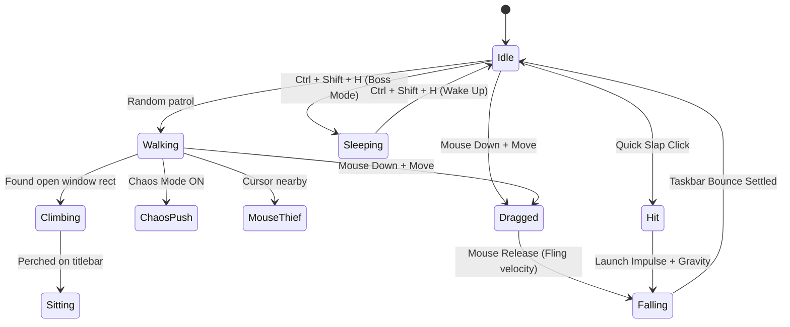

<a id="readme-top"></a>

<!-- CUSTOM 60FPS ANIMATED HERO SCENE -->
<div align="center">
  <a href="https://github.com/a1n2a3s6/minime-pet/releases">
    
  </a>

  <br />
  <br />

  <!-- LIVE DYNAMIC STATUS STRIP -->
  <p>
    <a href="https://github.com/a1n2a3s6/minime-pet/releases">
      
    </a>
    <a href="https://github.com/a1n2a3s6/minime-pet/stargazers">
      
    </a>
    <a href="https://github.com/a1n2a3s6/minime-pet/network/members">
      
    </a>
    
  </p>

  <!-- SLEEK JUMP NAV -->
  <p>
    <a href="#-live-desktop-chaos-preview"><strong>🎬 Live Preview</strong></a> &nbsp;│&nbsp;
    <a href="#-the-60-second-skin-pipeline"><strong>✂️ Chroma Key Pipeline</strong></a> &nbsp;│&nbsp;
    <a href="#-bento-feature-showcase"><strong>⚡ Powers</strong></a> &nbsp;│&nbsp;
    <a href="#-under-the-hood-win32--state-machine"><strong>🧠 Under the Hood</strong></a> &nbsp;│&nbsp;
    <a href="#-get-minime-windows-10--11"><strong>📦 Download</strong></a>
  </p>
</div>

---

> [!IMPORTANT]
> **Not another bloated Electron pet.** **MiniMe Pet** is engineered natively in **C# (.NET 8 + WPF + direct `user32.dll` Win32 P/Invoke)** to consume **~35 MB RAM**, run at a locked **60 FPS** always-on-top over every Windows app, turn **your own photo** into a custom animated 8-state character via green-screen auto-slicing, and physically interact with your desktop windows.

---

## 🎬 Live Desktop Chaos Preview

Watch how **MiniMe** operates live on your desktop — reading your active foreground app (`GetForegroundWindow`), physically shoving non-maximized windows (`SetWindowPos`), climbing titlebars (`GetWindowRect`), and playfully dragging your cursor (`SetCursorPos`):

<div align="center">
  
</div>

---

## ✂️ The 60-Second Skin Pipeline

AI image generators fail at real transparency (drawing fake gray checkerboards instead). **MiniMe** solves this with a built-in **AI Prompt Wizard + Real-Time `#00FF00` Chroma Key Engine** with edge spill suppression:

<div align="center">
  
</div>

<details>
<summary><b>📋 View the 8-Frame Sprite Sheet Specification &amp; Built-In Fallback</b></summary>

| Grid Slot | State Enum | Triggered When |
| :---: | :--- | :--- |
| `(Row 1, Col 1)` | `Idle` | Standing on taskbar or window titlebar with breathing motion |
| `(Row 1, Col 2)` | `Walk1` | Left-foot walk cycle frame (auto-mirrored when walking left) |
| `(Row 1, Col 3)` | `Walk2` | Right-foot walk cycle frame |
| `(Row 1, Col 4)` | `Troll` | Delivering a context-aware roast, pushing a window, or stealing the mouse |
| `(Row 2, Col 1)` | `Hit` | Slapped or bouncing off walls/taskbar with spinning dizzy stars |
| `(Row 2, Col 2)` | `Dragged` | Picked up by the collar with the mouse cursor before being flung |
| `(Row 2, Col 3)` | `Sitting` | Perched on top of an active app's titlebar dangling its legs |
| `(Row 2, Col 4)` | `Sleeping` | Resting quietly in the corner during **Boss / Focus Mode (`Ctrl+Shift+H`)** |

> [!TIP]
> **Works Out of the Box:** MiniMe ships with a built-in procedurally drawn animated Chibi character, so you can launch it immediately and swap in your own face whenever you want!

</details>

---

## ⚡ Bento Feature Showcase

<table>
  <tr>
    <td width="33%" valign="top">
      <h3>🧠 Context-Aware Roasts</h3>
      <p>Inspects your active foreground window every 20–45s. Coding too long in VS Code? Bingeing YouTube? MiniMe drops witty <b>Egyptian Arabic</b> or <b>English</b> speech bubbles right on screen.</p>
      <code>GetForegroundWindow()</code>
    </td>
    <td width="33%" valign="top">
      <h3>😈 Toggleable Chaos Mode</h3>
      <p>Shoves open windows sideways, shakes them playfully, chases your cursor for 1.2s, or sneakily hits minimize. Every chaos behavior can be toggled independently in Settings.</p>
      <code>SetWindowPos() • SetCursorPos()</code>
    </td>
    <td width="33%" valign="top">
      <h3>🏀 60fps Slap &amp; Throw Physics</h3>
      <p>Single-click to slap MiniMe across the monitor with gravity, wall bounce, and dizzy stars — or grab it by the collar and fling it with real release velocity.</p>
      <code>CompositionTarget.Rendering</code>
    </td>
  </tr>
  <tr>
    <td width="33%" valign="top">
      <h3>🤖 Offline + Optional AI Brain</h3>
      <p>Runs <b>100% offline</b> with a curated JSON quip library — or drop in a free <b>Gemini Flash</b> / <b>Groq</b> API key to unlock dynamic roasts and double-click mini-bubble chat.</p>
      <code>Offline JSON • Gemini • Groq</code>
    </td>
    <td width="33%" valign="top">
      <h3>🧗 Real Window Climber</h3>
      <p>Scans visible non-maximized windows, calculates their exact screen bounds, hops onto their top edge, and sits there watching you work.</p>
      <code>EnumWindows() • GetWindowRect()</code>
    </td>
    <td width="33%" valign="top">
      <h3>🤫 Instant Boss / Focus Mode</h3>
      <p>Gaming, recording, or in a meeting? Hit <kbd>Ctrl</kbd>+<kbd>Shift</kbd>+<kbd>H</kbd> from any app to instantly send MiniMe to sleep in the corner with zero interruptions.</p>
      <code>RegisterHotKey()</code>
    </td>
  </tr>
</table>

---

## 🧠 Under the Hood: Win32 & State Machine



<details>
<summary><b>🔬 Inspect Native Win32 Interop &amp; Safety Guardrails</b></summary>

MiniMe talks directly to Windows via zero-dependency P/Invoke (`src/MiniMe/Native/Win32Interop.cs`) with strict OS safety guardrails:
- **Never touches system shell windows** (`Progman`, `WorkerW`, `Shell_TrayWnd`, `TaskManager`).
- **Never moves maximized or fullscreen apps/games** (`IsZoomed(hwnd)` check).
- **Zero admin privileges required** and **zero background telemetry**.

```csharp
// Example: Safe non-maximized window shove via native user32.dll
[DllImport("user32.dll", SetLastError = true)]
public static extern bool SetWindowPos(
    IntPtr hWnd, IntPtr hWndInsertAfter,
    int X, int Y, int cx, int cy, uint uFlags
);
```

</details>

<details>
<summary><b>📂 Inspect Full C# .NET 8 Repository Tree</b></summary>

```text
minime-pet/
├── assets/
│   ├── hero.svg                        # Custom 60fps animated hero banner
│   ├── desktop-demo.svg                # Live animated Windows 11 chaos simulation
│   └── chroma-pipeline.svg             # Animated Chroma Key laser-scan diagram
├── .github/
│   └── workflows/
│       └── release.yml                 # Auto-builds standalone minime-windows-x64.exe
├── src/
│   └── MiniMe/
│       ├── MiniMe.csproj               # .NET 8 WPF + WinForms Tray (Zero external NuGet)
│       ├── App.xaml / App.xaml.cs      # System Tray menu & Ctrl+Shift+H global hotkey
│       ├── Native/
│       │   └── Win32Interop.cs         # Native user32.dll P/Invoke + OS safety guards
│       ├── Engine/
│       │   ├── SpriteProcessor.cs      # #00FF00 Chroma Key remover + 4x2 Auto-Slicer
│       │   ├── PhysicsEngine.cs        # 60fps gravity, bounce, slap & fling physics
│       │   ├── ChaosEngine.cs          # Climber, Window Pusher, Mouse Thief & Minimizer
│       │   └── BrainService.cs         # Context-aware Offline JSON + Gemini/Groq AI
│       ├── Models/
│       │   ├── PetConfig.cs
│       │   └── PetState.cs
│       ├── Assets/
│       │   └── quips.json              # Categorized Egyptian Arabic & English quips
│       └── Views/
│           ├── PetWindow.xaml(.cs)     # Transparent Always-On-Top overlay & chat bubble
│           ├── SetupWindow.xaml(.cs)   # Style picker → AI Prompt → Chroma Key preview
│           └── SettingsWindow.xaml(.cs)# Chaos toggles, API Key & language controls
└── README.md
```

</details>

---

## 📦 Get MiniMe (Windows 10 / 11)

<table>
  <tr>
    <td width="50%" valign="top">
      <h3>🚀 Option 1 — Standalone <code>.EXE</code> (Zero Install)</h3>
      <p>Download the pre-compiled single-file executable directly from GitHub Releases and double-click to launch:</p>
      <p>
        <a href="https://github.com/a1n2a3s6/minime-pet/releases">
          
        </a>
      </p>
    </td>
    <td width="50%" valign="top">
      <h3>🛠️ Option 2 — Build From Source (.NET 8 SDK)</h3>

```powershell
git clone [https://github.com/a1n2a3s6/minime-pet.git](https://github.com/a1n2a3s6/minime-pet.git)
cd minime-pet
dotnet run --project src/MiniMe/MiniMe.csproj
```

    </td>
  </tr>
</table>

---

## ⌨️ Controls & Shortcuts

| Gesture / Key | Effect |
| :---: | :--- |
| **Quick Single Click** | Slap MiniMe — launches diagonally with gravity, dizzy stars & sarcastic quip |
| **Click & Drag** | Pick MiniMe up by the collar (`Dragged` pose) and fling across the screen |
| **Double Click** | Open mini chat bubble (AI Mode) or trigger an instant context-aware roast |
| **Right Click / Tray Icon** | Open Skin Setup Wizard, Settings, Toggle Chaos, or Summon to Center |
| <kbd>Ctrl</kbd> + <kbd>Shift</kbd> + <kbd>H</kbd> | **Boss / Focus Mode** — instant corner sleep & pause all Win32 chaos |

---

<div align="center">

<h3>👨‍💻 Engineered by Anas Alhelaly</h3>
<p><em>Day 11 of my <strong>365 Projects in 365 Days</strong> GitHub Challenge</em></p>

<p>
  <a href="https://anas-alhelaly.vercel.app/">
    
  </a>
  <a href="https://github.com/a1n2a3s6">
    
  </a>
  <a href="https://www.instagram.com/anas.alhelaly/">
    
  </a>
</p>

<p>⭐ <strong>If MiniMe made you laugh (or shoved your VS Code window), drop a Star on the repo!</strong> ⭐</p>

<p><a href="#readme-top"><strong>⬆️ Back to Top</strong></a></p>

</div>
