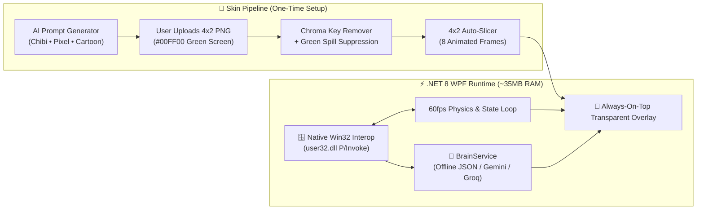

<a id="readme-top"></a>

<!-- HERO ANIMATED BANNER -->
<div align="center">
  

  <!-- ANIMATED TYPING TAGLINE -->
  <a href="https://github.com/a1n2a3s6/minime-pet">
    
  </a>

  <br />

  <!-- TECH & PLATFORM BADGES -->
  <p>
    
    
    
    
    
  </p>

  <!-- LIVE GITHUB REPOSITORY STATS -->
  <p>
    <a href="https://github.com/a1n2a3s6/minime-pet/stargazers">
      
    </a>
    <a href="https://github.com/a1n2a3s6/minime-pet/releases">
      
    </a>
    <a href="https://github.com/a1n2a3s6/minime-pet/commits/main">
      
    </a>
    
  </p>

  <!-- QUICK NAVIGATION BAR -->
  <p>
    <a href="#-how-the-custom-skin-wizard-works"><strong>🎨 Custom Skin Setup</strong></a> &nbsp;│&nbsp;
    <a href="#-desktop-chaos--win32-powers"><strong>😈 Chaos Powers</strong></a> &nbsp;│&nbsp;
    <a href="#-architecture"><strong>🏗️ Architecture</strong></a> &nbsp;│&nbsp;
    <a href="#-download--install"><strong>📦 Download .EXE</strong></a> &nbsp;│&nbsp;
    <a href="#-shortcuts--controls"><strong>⌨️ Controls</strong></a>
  </p>
</div>

---

> [!IMPORTANT]
> **Zero heavy 3D GPUs. Zero cloud subscriptions. Pure native Windows chaos.**
> **MiniMe Pet** is an ultra-lightweight **C# (.NET 8 + WPF)** Desktop Buddy that lives always-on-top over every Windows app, interacts with your real desktop windows via **Win32 API**, roasts you based on what you're doing (in Egyptian Arabic or English), and lets you turn **your own photo** into a custom animated 8-frame skin in 60 seconds using our built-in **AI Prompt Generator + Chroma Key (`#00FF00`) Auto-Slicer**.

---

## 🎨 How the Custom Skin Wizard Works

Instead of bloating the app with gigabytes of local AI models, **MiniMe** separates image generation from runtime performance:

1. **Pick Your Style:** Choose **Chibi Anime**, **Pixel Art**, or **2D Cartoon** inside the Setup Wizard.
2. **Copy the Magic Prompt:** MiniMe gives you a precision-engineered prompt requesting a **4×2 Sprite Sheet (8 poses)** on a pure `#00FF00` green screen. Paste it with your selfie into any AI image generator.
3. **Upload & Auto-Slice:** Drop the image into MiniMe — the built-in **Chroma Key Engine** strips the green screen cleanly (with spill suppression) and slices all 8 frames automatically!

| Row | Col 1 | Col 2 | Col 3 | Col 4 |
| :---: | :---: | :---: | :---: | :---: |
| **Row 1** | 🧍 `Idle` | 🚶 `Walk 1` | 🏃 `Walk 2` | 😈 `Troll / Laugh` |
| **Row 2** | 💫 `Hit / Dizzy` | 🤏 `Dragged` | 🪑 `Sitting` | 😴 `Sleeping` |

> [!TIP]
> Don't have a custom sprite sheet yet? **MiniMe ships with a built-in animated Chibi character** so you can launch and enjoy it immediately out of the box!

---

## 😈 Desktop Chaos & Win32 Powers

<table>
  <tr>
    <td width="50%" valign="top">
      <h3>🧠 Context-Aware Trolling</h3>
      <p>Reads your active foreground window (<code>GetForegroundWindow</code>). Coding in VS Code for hours? It tells you to drink water. Procrastinating on YouTube? It calls you out in hilarious <b>Egyptian Arabic</b> or English speech bubbles.</p>
    </td>
    <td width="50%" valign="top">
      <h3>🧗 Real Window Climber</h3>
      <p>Locates open non-maximized windows via <code>GetWindowRect</code>, leaps up onto their titlebar, and sits there dangling its legs while watching you work.</p>
    </td>
  </tr>
  <tr>
    <td width="50%" valign="top">
      <h3>💥 Win32 Chaos Mode (Toggleable)</h3>
      <p>Physically shoves/shakes your open windows (<code>SetWindowPos</code>), chases and playfully steals your mouse cursor for a second (<code>SetCursorPos</code>), or sneakily minimizes a window and hides.</p>
    </td>
    <td width="50%" valign="top">
      <h3>🏀 Real 2D Slap &amp; Throw Physics</h3>
      <p>Click fast to <b>slap</b> MiniMe across the screen with gravity and taskbar bounce (complete with spinning dizzy stars!), or grab it by the collar and <b>fling</b> it anywhere.</p>
    </td>
  </tr>
  <tr>
    <td width="50%" valign="top">
      <h3>🤖 Offline Quips + Optional AI Chat</h3>
      <p>Works 100% offline with a rich categorized JSON quip pack — or plug in a free <b>Gemini Flash</b> / <b>Groq</b> API key to unlock live context-aware roasts and double-click mini-bubble chat!</p>
    </td>
    <td width="50%" valign="top">
      <h3>🤫 Instant Boss / Focus Mode</h3>
      <p>Press <kbd>Ctrl</kbd> + <kbd>Shift</kbd> + <kbd>H</kbd> from any app or game to put MiniMe to sleep in the corner and pause all Chaos actions instantly.</p>
    </td>
  </tr>
</table>

---

## 🏗️ Architecture



<details>
<summary><b>📂 Click to expand full C# .NET 8 project structure</b></summary>

```text
minime-pet/
├── .github/
│   └── workflows/
│       └── release.yml                # Automated single-file Windows .exe build
├── src/
│   └── MiniMe/
│       ├── MiniMe.csproj              # .NET 8 WPF + WinForms Tray (Zero external NuGet deps)
│       ├── App.xaml / App.xaml.cs     # System Tray icon & Ctrl+Shift+H global hotkey
│       ├── Native/
│       │   └── Win32Interop.cs        # P/Invoke bindings for user32.dll
│       ├── Engine/
│       │   ├── SpriteProcessor.cs     # Chroma Key remover, 4x2 slicer & fallback sprite
│       │   ├── PhysicsEngine.cs       # Gravity, bounce, slap launch & fling velocity
│       │   ├── ChaosEngine.cs         # Window Climber, Pusher, Mouse Thief & Minimizer
│       │   └── BrainService.cs        # Context-aware offline quips + Gemini/Groq API
│       ├── Models/
│       │   ├── PetConfig.cs
│       │   └── PetState.cs
│       ├── Assets/
│       │   └── quips.json             # Categorized Egyptian Arabic & English quips
│       └── Views/
│           ├── PetWindow.xaml(.cs)    # Transparent Always-On-Top pet & speech bubble
│           ├── SetupWindow.xaml(.cs)  # AI Prompt + Chroma Key Auto-Slicer Wizard
│           └── SettingsWindow.xaml(.cs)
└── README.md
```

</details>

---

## 📦 Download & Install

### Option 1: Standalone Windows `.exe` (Zero Install)
Download **`minime-windows-x64.exe`** directly from **[GitHub Releases](https://github.com/a1n2a3s6/minime-pet/releases)** and double-click to run!

### Option 2: Build from Source (.NET 8 SDK)
```powershell
git clone [https://github.com/a1n2a3s6/minime-pet.git](https://github.com/a1n2a3s6/minime-pet.git)
cd minime-pet
dotnet run --project src/MiniMe/MiniMe.csproj
```

---

## ⌨️ Shortcuts & Controls

| Interaction | Action |
| :---: | :--- |
| **Single Quick Click** | Slap MiniMe (launches with gravity, dizzy stars & sarcastic reply) |
| **Click & Drag** | Pick MiniMe up by the collar and fling across the screen |
| **Double Click** | Open mini chat bubble (AI Mode) or trigger a fresh context roast |
| **Right Click / Tray Icon** | Open Skin Setup Wizard, Settings, or Summon to Center |
| <kbd>Ctrl</kbd> + <kbd>Shift</kbd> + <kbd>H</kbd> | **Boss / Focus Mode** — instant sleep & pause all Chaos |

---

## 🗺️ Roadmap

- [x] Native C# .NET 8 WPF transparent Always-On-Top pet with 60fps throw/slap physics
- [x] Built-in AI 4×2 Sprite Prompt Generator + Chroma Key (`#00FF00`) Auto-Slicer
- [x] Win32 API Window Climber, Window Pusher, Mouse Thief & Context-Aware Trolling
- [x] Offline Egyptian Arabic / English quips + Optional Gemini Flash / Groq AI chat
- [x] Global `Ctrl+Shift+H` Boss Mode + Automated single-file `.exe` GitHub Release
- [ ] Multi-Pet Mode (spawn 2 MiniMes that argue with each other on your taskbar)
- [ ] Optional retro sound effects pack (slap, boing, giggle)
- [ ] Community Skin Marketplace (export/import `.minime` skin packs)

---

## 📄 License

Distributed under the **MIT License**. Free to use, customize, and share!

---

<div align="center">

<h3>👨‍💻 Built by Anas Alhelaly</h3>
<p><em>Day 11 of my <strong>365 Projects in 365 Days</strong> GitHub Challenge</em></p>

<p>
  <a href="https://anas-alhelaly.vercel.app/">
    
  </a>
  <a href="https://github.com/a1n2a3s6">
    
  </a>
  <a href="https://www.instagram.com/anas.alhelaly/">
    
  </a>
</p>

<p>⭐ <strong>If MiniMe made you laugh (or stole your mouse), drop a Star on the repo!</strong> ⭐</p>

<p><a href="#readme-top"><strong>⬆️ Back to Top</strong></a></p>

<!-- ANIMATED WAVE FOOTER -->


</div>
